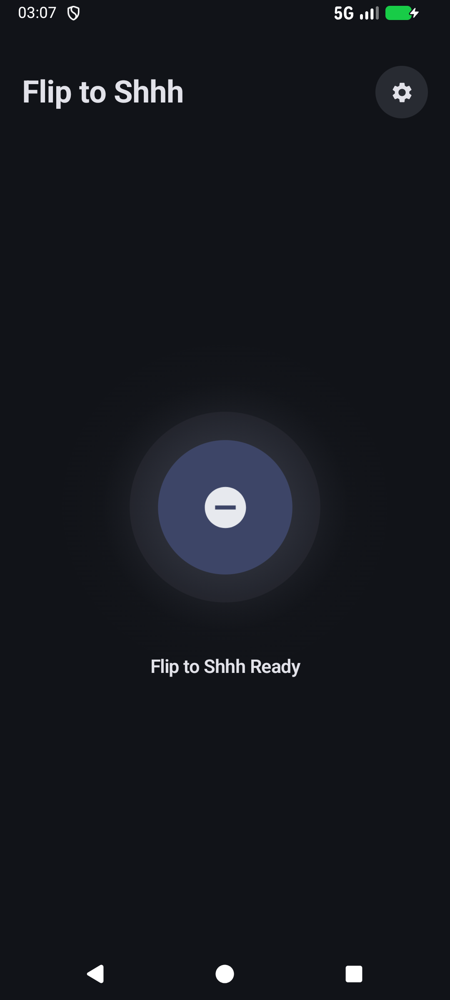
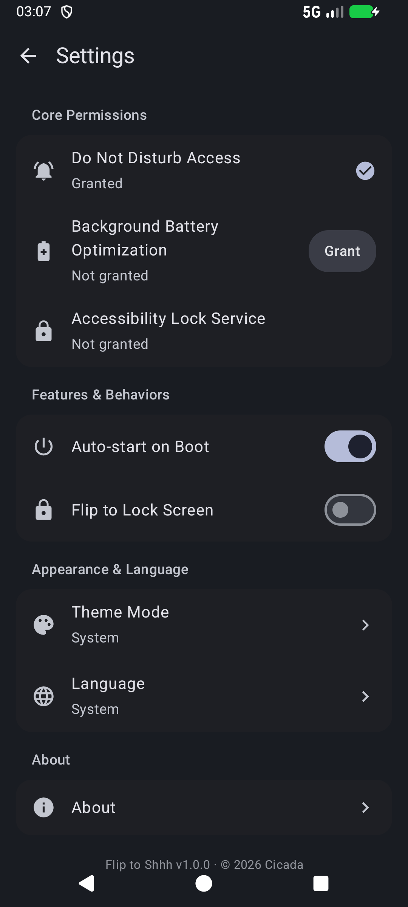
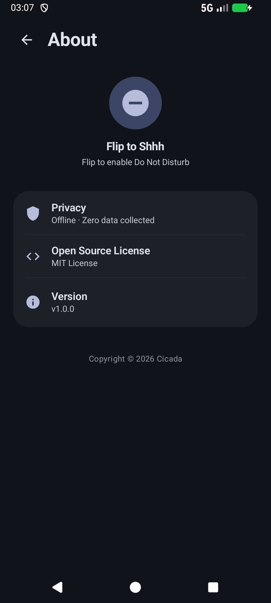

<div align="center">

# flip2shhh

**Flip to Shhh** · flip it over, tune the world out



An open-source Android utility: place your phone face down on a desk for two seconds and Do Not Disturb turns on by itself. Pick it up or flip it back, and the previous state is restored. Optionally locks the screen as it flips.

This branch is the **Memorial Edition (v2.1.5.3)**: the same utility plus a terminal music-player easter egg.

[简体中文](README_zh-CN.md) · English · [繁體中文](README_zh-TW.md)

</div>

---

It does one job: use the sensors to decide whether the phone is resting face down on a surface, then operate the system Do Not Disturb switch for you. No internet permission, no analytics, no account.

## How it works

### Face-down detection

- **Gravity orientation.** A flat phone reads about `(0, 0, −9.8) m/s²`; face down, Z is strongly negative. Entry requires `Z ≤ −9.0` and a horizontal magnitude `√(X²+Y²) ≤ 2.5` (roughly 23° and 15° of tolerance for camera bumps and cases).
- **Two-second stillness.** The candidate pose must remain stationary for 2.0 s. During the countdown the motion sensors oversample at ~50 Hz and any hand tremor (gyroscope > 0.05 rad/s or frame-to-frame acceleration > 0.07 m/s²) restarts the timer, which prevents false triggers while the phone is held face down in the air.
- **Proximity fusion with a fallback.** When a real optical proximity sensor reports, a fresh NEAR reading confirms the screen is against a surface. If the sensor never reports, or its last reading is older than 5 s, detection falls back to the stillness check instead of blocking forever; this avoids the "proximity sensor locks out flip detection" failure on devices with restricted or non-reporting sensors.
- **Asymmetric exit.** Lifting or tilting uses looser thresholds (`Z > −7.5` or horizontal > 3.5), so nudging the phone on the desk does not accidentally turn DND off.
- **Power-aware sampling.** The gyroscope and the fast sensor rate are enabled only during the countdown; idle detection uses the low-power UI rate. A short partial wake lock keeps the timer and sensor callbacks alive while the screen is off.

### The DND state machine

Once a flip is confirmed, the app calls `NotificationManager.setInterruptionFilter(INTERRUPTION_FILTER_PRIORITY)`. It records whether it was the one that turned DND on:

- If DND was off before the flip, flipping back restores `INTERRUPTION_FILTER_ALL`.
- If DND was already on (a system schedule, a manual toggle, or another app), the service never turns it off.
- External DND changes are observed through `ACTION_INTERRUPTION_FILTER_CHANGED`; the service resets its own state when the user turns DND off manually.
- State is persisted, so a service restart re-checks the live system filter before continuing. Revoking notification-policy access stops the service immediately.

### Flip-to-lock (optional)

An accessibility service calls `GLOBAL_ACTION_LOCK_SCREEN` so the screen locks as the phone goes face down. The service declares `canRetrieveWindowContent="false"` and reads nothing from the screen. Biometric unlock is unaffected.

### Service and interface

The detector runs in a `specialUse` foreground service with a minimal-importance notification, starts on boot when enabled, and returns `START_STICKY`. The Compose interface provides onboarding, permission status, an optional auto-start switch, an auto-lock switch, language selection (Simplified Chinese, Traditional Chinese, English), theme selection, and Material 3 dynamic color.

### Terminal easter egg (Memorial Edition)

Seven taps on the version row in the About page open an Ubuntu-style terminal. It types a `neofetch` snapshot and a `./coralsea-cli` command, reads synchronized lyrics from the OGG comment field, plays the embedded track through `MediaPlayer` with audio focus, and types each lyric line against the real playback position. The closing `sudo rm -rfv /*` is simulated terminal text only; nothing on the device is touched.

## Two editions (final)

- **Memorial Edition — `easter-egg`, v2.1.5.3 (this branch).** The same foundation plus the terminal music-player easter egg.
- **Standard Edition — `main`, v1.0.4.** The clean daily-use build without the easter egg.

Both editions share the package name `shhh.cicada.flip` and one signing key. Installing one over the other requires uninstalling the first.

## Download

Grab an APK from [Releases](https://github.com/wg2038/flip2shhh/releases). Requires Android 13 or newer.

## Build

```bash
git clone https://github.com/wg2038/flip2shhh.git
cd flip2shhh
./gradlew assembleDebug
```

Output lands in `app/build/outputs/apk/debug/`. Needs Android SDK 34.

## Privacy

The app requests no internet permission and includes no analytics or tracking SDK. Sensor readings are used in memory for pose detection only; they are never written to disk or uploaded.

## Final update

**2026-10-18** · Version 2.1.5.3 is the final Memorial Edition. This last revision was completed with the DeepSeek v4.1 Flash model. No further updates are planned unless something unexpected happens.

## License

[MIT](LICENSE)
