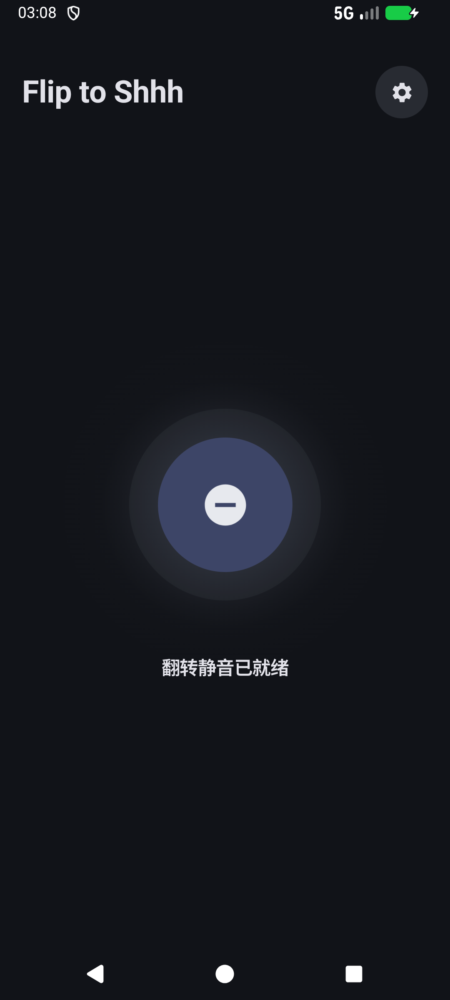
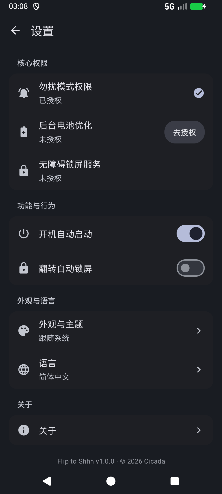
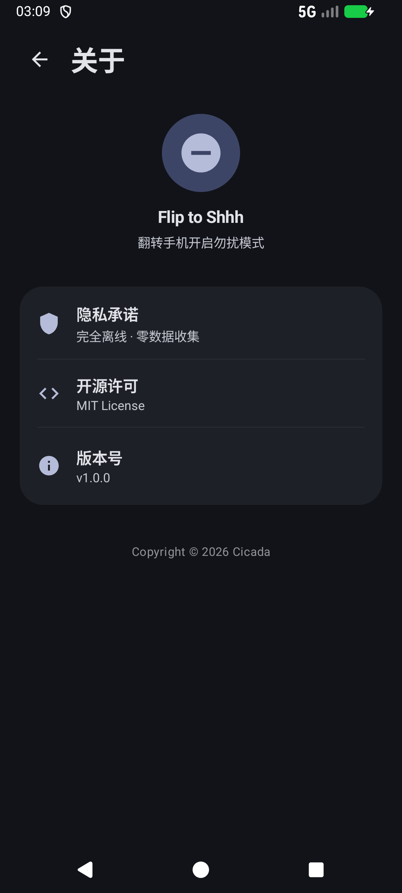

<div align="center">

# flip2shhh

**Flip to Shhh** · 翻过去，安静下来



一个开源的 Android 小工具：手机屏幕朝下放平两秒，自动开启勿扰；拿起来或翻回正面，恢复之前的状态。可选在翻面时顺手锁屏。

简体中文 · [English](README.md) · [繁體中文](README_zh-TW.md)

</div>

---

它只做一件事：用传感器判断手机是否正面朝下平放在桌面上，然后替你操作系统的勿扰开关。没有网络权限，没有分析统计，不需要账号。

## 实现原理

### 翻面检测

- **重力方向。** 手机平放时重力传感器约为 `(0, 0, −9.8) m/s²`；屏幕朝下时 Z 轴明显为负。进入判定要求 `Z ≤ −9.0` 且水平分量 `√(X²+Y²) ≤ 2.5`，为相机凸起和手机壳留出约 23° / 15° 的容差。
- **两秒静止。** 候选姿态必须连续保持 2.0 秒。倒计时期间运动传感器提升到约 50 Hz 过采样，陀螺仪大于 0.05 rad/s 或帧间加速度大于 0.07 m/s² 就重置计时，避免手机拿在手里悬空朝下时误触发。
- **接近传感器融合与回退。** 真实光学接近传感器有读数时，用最新的 NEAR 读数确认屏幕贴着表面；如果传感器从未上报，或最近一次读数已超过 5 秒，则回退到静止判定，不会像旧版本那样被无读数传感器永久锁死。
- **不对称退出。** 拿起或倾斜使用更宽松的阈值（`Z > −7.5` 或水平分量 > 3.5），在桌面上小幅挪动不会误关勿扰。
- **按需采样。** 陀螺仪和高速采样只在倒计时期间开启，空闲时使用低功耗 UI 采样率；短暂持有 `PARTIAL_WAKE_LOCK`，保证熄屏时计时器和传感器回调继续运行。

### 勿扰状态机

确认翻面后，应用调用 `NotificationManager.setInterruptionFilter(INTERRUPTION_FILTER_PRIORITY)` 开启勿扰，并记录这次勿扰是不是自己开启的：

- 翻面前勿扰是关闭的：翻回来时恢复 `INTERRUPTION_FILTER_ALL`。
- 翻面前勿扰已经开着（系统睡眠排程、手动开关或其他应用）：服务不会擅自关闭它。
- 通过 `ACTION_INTERRUPTION_FILTER_CHANGED` 监听外部变化；用户手动关掉勿扰时同步清理内部状态。
- 状态会持久化保存，服务进程重启后先核对当前系统勿扰状态再决定是否延续。通知策略权限被撤销时，服务立即停止。

### 翻面锁屏（可选）

通过无障碍服务调用系统的 `GLOBAL_ACTION_LOCK_SCREEN`，翻面时顺手熄屏锁定。服务声明了 `canRetrieveWindowContent="false"`，不读取任何屏幕内容，指纹和面部解锁不受影响。

### 服务与界面

检测逻辑运行在 `specialUse` 前台服务中，常驻通知使用最低重要性；开启开机自启后会随系统启动，并返回 `START_STICKY`。Compose 界面包含引导页、权限状态、开机自启与自动锁屏开关、语言选择（简体中文 / 繁體中文 / English）、主题切换和 Material 3 动态取色。

## 两个版本（最终版）

- **标准版 —— `main` 分支，v1.0.4**：上述日常使用版本。
- **纪念版 —— `easter-egg` 分支，v2.1.5.3**：相同底座，外加一个终端音乐播放器彩蛋；在关于页连续点击版本号七次，会打开一个 Linux 风格终端，播放内嵌歌曲并显示同步歌词。

两个版本使用相同的包名 `shhh.cicada.flip` 和同一签名，安装其中一个后再装另一个需要先卸载。

## 下载

从 [Releases](https://github.com/wg2038/flip2shhh/releases) 下载 APK。系统要求 Android 13 及以上。

## 构建

```bash
git clone https://github.com/wg2038/flip2shhh.git
cd flip2shhh
./gradlew assembleDebug
```

产物在 `app/build/outputs/apk/debug/`。需要 Android SDK 34。

## 隐私

应用不申请网络权限，不包含分析或追踪 SDK。传感器读数只在内存中用于姿态判断，不落盘、不上传。

## 最终更新

**2026-10-18** · 1.0.4 是标准版的最终版本。本次最终修改由 DeepSeek v4.1 Flash 模型完成。如无意外，后续不再更新。

## 许可

[MIT](LICENSE)
